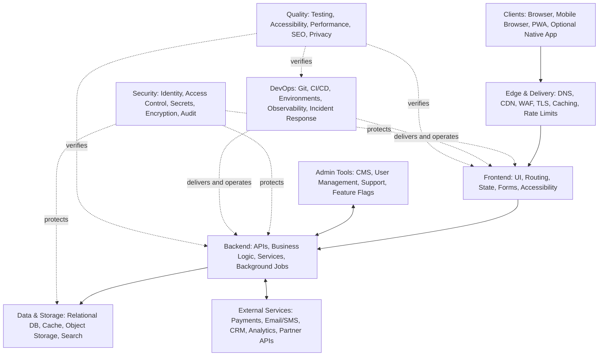

# Universal Website Development Blueprint

**A reusable engineering map for planning, designing, building, securing, deploying, and operating modern websites and web applications.**

Designed and developed by **Aditya Narayan Rautaray**.

> **Core principle:** Scale modules to the product, not the other way around. Start with the smallest safe architecture that meets requirements; add complexity only when justified.

---

## 🚀 Explore the Interactive Architecture

Explore the complete interactive, eight-page architecture diagram:

### [Open Universal Website Development Blueprint →](https://duskforged-coder.github.io/universal-website-development-blueprint/diagrams/ARYAVAX_Universal_Website_Development_Blueprint.drawio-2.drawio.html)

The diagram provides a visual overview of the architecture, its modules, their relationships, and the overall application lifecycle.

You can also access the editable Draw.io source in the [`diagrams/`](diagrams/) directory. Open the file using [diagrams.net](https://app.diagrams.net/).

---

## 📌 What Is This Project?

The **Universal Website Development Blueprint** is a technology-independent reference architecture designed to organize the major engineering concerns involved in building modern websites and web applications.

It explains how different components fit together and provides a practical method for adapting architecture to projects of different sizes and requirements.

This is an architectural guide, not a mandatory technology stack, framework, vendor recommendation, or claim that every project needs every component.

## 🏗️ Architecture at a Glance

The following diagram illustrates the major layers and cross-cutting concerns of a modern web application.



---

## 🧩 The Eight Architecture Views

Each architecture view focuses on a specific engineering domain.

| Architecture View | What It Covers |
|---|---|
| [00 — Master Blueprint](docs/01-overview.md) | Product definition, clients, edge delivery, application layers, security, operations, integrations, admin tools, and quality |
| [01 — Frontend Architecture](docs/02-frontend-architecture.md) | Runtime, routing, design systems, components, feature modules, state, forms, accessibility, assets, API clients, and testing |
| [02 — Backend Architecture](docs/03-backend-architecture.md) | API gateways, interfaces, identity, domain services, asynchronous processing, adapters, persistence, observability, and testing |
| [03 — Data & Storage](docs/04-data-and-storage.md) | Relational and other databases, caching, object storage, search, queues, analytics, backup, recovery, and governance |
| [04 — Security Architecture](docs/05-security-architecture.md) | Attack surface, identity, access control, application defense, network security, data protection, supply chain, detection, and response |
| [05 — DevOps & Operations](docs/06-devops-and-operations.md) | Source control, CI, build artifacts, releases, environments, infrastructure as code, observability, backup, and operations |
| [06 — Integrations & Modules](docs/07-integrations-and-modules.md) | Commerce, content, communication, analytics, enterprise capabilities, optional AI/automation, location/search, and mobile/PWA |
| [07 — How to Use](docs/08-implementation-guide.md) | Discover, classify, design, build, verify, operate, and evolve |

---

## ⚙️ Core Architecture Principles

1. **Requirements First:** Define users, journeys, business outcomes, scope, constraints, compliance, budget, and success metrics before choosing infrastructure.
2. **Conditional Modules:** Classify every capability as Required, Optional, or Not Needed. Document why optional modules are included.
3. **Explicit Trust Boundaries:** Treat browser input, external APIs, uploads, webhooks, and privileged administrative actions as untrusted until validated and authorized.
4. **Server-Side Authorization:** Never rely exclusively on client-side checks to protect sensitive operations.
5. **Safe Failure Behavior:** Define timeouts, retries, idempotency, graceful fallbacks, and recovery expectations.
6. **Operational Readiness:** Monitoring, backups, restore tests, incident ownership, and rollback are part of the architecture.
7. **Evidence-Based Complexity:** Scale only when product requirements, traffic, reliability, security, or operational evidence justifies it.

---

## 🚀 Quick Start

Use this blueprint as a starting point for your next website or web application.

1. Identify the product, users, important journeys, data, integrations, constraints, and success measures.
2. Open the Draw.io file and review the Master Blueprint.
3. Classify every module as **Required**, **Optional**, or **Not Needed**.
4. Select an architecture style and technology stack that fit the requirements and team.
5. Define data ownership, API contracts, trust boundaries, failure modes, and deployment topology.
6. Build in vertical slices: User Journey → UI → API → Data → Tests → Telemetry.
7. Verify functionality, authorization, accessibility, performance, privacy, backup recovery, and operational readiness.
8. Monitor real usage, incidents, and costs. Evolve the architecture when evidence supports the change.

For a detailed workflow, see the [Implementation Guide](docs/08-implementation-guide.md).

---

## 📁 Suggested Project Structure

The following is an illustrative starting point, not a mandatory folder structure.

```text
project/
├── frontend/
│   ├── app-or-pages/
│   ├── components/
│   ├── features/
│   ├── lib/
│   └── tests/
│
├── backend/
│   ├── api/
│   ├── domain/
│   ├── services/
│   ├── workers/
│   ├── integrations/
│   └── tests/
│
├── database/
│   ├── migrations/
│   └── seeds/
│
├── infrastructure/
├── docs/
└── .github/
```

Adapt the structure to the language, framework, deployment model, and team size you actually use.

---

## ✅ Quality & Verification Checklist

Use this checklist before considering an implementation production-ready.

- [ ] Requirements and success metrics are documented.
- [ ] Every module is classified as Required, Optional, or Not Needed.
- [ ] Sensitive operations have server-side authorization checks.
- [ ] Inputs, uploads, and webhooks are validated.
- [ ] Secrets are not committed to source control or exposed to clients.
- [ ] Retries are safe and important operations are idempotent.
- [ ] Unit, integration, contract, and end-to-end tests match system risks.
- [ ] Accessibility, performance, and SEO are checked where relevant.
- [ ] Logs, metrics, traces, and actionable alerts are configured.
- [ ] Backups are healthy and restore procedures have been tested.
- [ ] Release approval, migration review, and rollback procedures are understood.
- [ ] Privacy, retention, deletion, and vendor data sharing are documented.

---

## 📦 Repository Contents

```text
universal-website-development-blueprint/
│
├── README.md
├── LICENSE
├── CONTRIBUTING.md
├── CODE_OF_CONDUCT.md
│
├── diagrams/
│   ├── README.md
│   └── universal-website-development-blueprint.drawio
│
├── docs/
│   ├── 01-overview.md
│   ├── 02-frontend-architecture.md
│   ├── 03-backend-architecture.md
│   ├── 04-data-and-storage.md
│   ├── 05-security-architecture.md
│   ├── 06-devops-and-operations.md
│   ├── 07-integrations-and-modules.md
│   └── 08-implementation-guide.md
│
└── .github/
    └── ISSUE_TEMPLATE/
        ├── bug-report.md
        └── feature-request.md
```

---

## 🤝 Contributing

Suggestions, corrections, and improvements are welcome!

If you would like to contribute:

1. Read [CONTRIBUTING.md](CONTRIBUTING.md).
2. Open an issue for substantial changes.
3. Explain the architectural problem or improvement.
4. Submit changes with clear documentation.

Please keep proposals technology-neutral unless a concrete technology example is explicitly labelled as an example.

---

## ❤️ Support Future Projects

If you find this blueprint useful and would like to support my future independent engineering, open-source, and research projects, voluntary contributions are appreciated.

Your support can help fund development resources, experimentation, learning, and future project releases.

### [☕ Support My Future Projects — Razorpay](https://razorpay.me/@adityanarayanrautaray)

Every contribution is appreciated. Thank you for supporting independent development!

---

## 📜 Scope & Disclaimer

This blueprint provides educational and architectural guidance. It does not guarantee security, regulatory compliance, availability, or performance.

Every implementation must be threat-modelled, tested, reviewed, and adapted to its own legal, technical, and business requirements.

## 📄 License

Released under the [MIT License](LICENSE).

---

**Author:** Aditya Narayan Rautaray  
**Project:** Universal Website Development Blueprint  
**Repository:** [DuskForged-Coder/universal-website-development-blueprint](https://github.com/DuskForged-Coder/universal-website-development-blueprint)

If this project helps you, consider giving it a ⭐ on GitHub, sharing it, or contributing improvements.
