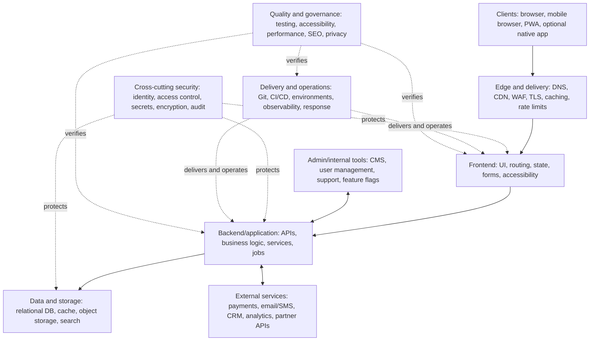

# Universal Website Development Blueprint

**A reusable engineering map for planning, designing, building, securing, deploying, and operating modern websites and web applications.**

Designed and developed by **Aditya Narayan Rautaray**.

> **Core principle:** Scale modules to the product, not the other way around. Start with the smallest safe architecture that meets requirements; add complexity only when justified.


## You may see Architecture here

Explore the complete interactive, 8-page architecture diagram:

[🚀 Open Universal Website Development Blueprint](https://duskforged-coder.github.io/universal-website-development-blueprint/diagrams/ARYAVAX_Universal_Website_Development_Blueprint.drawio-2.drawio.html)

## What this project is

The Universal Website Development Blueprint is a technology-independent reference architecture. It organizes the major concerns involved in a modern website or web application into understandable modules, explains how those modules relate, and provides a practical method for adapting them to projects of different sizes.

It is a guide, not a mandatory stack, framework, vendor recommendation, or claim that every project needs every component.

## Architecture at a glance



The complete editable, multi-page diagram is available at [`diagrams/universal-website-development-blueprint.drawio`](diagrams/universal-website-development-blueprint.drawio). Open it with [diagrams.net](https://app.diagrams.net/).

## The eight architecture views

| View | What it covers |
|---|---|
| [00 — Master Blueprint](docs/01-overview.md) | Product definition, clients, edge delivery, application layers, security, operations, integrations, admin tools, and quality |
| [01 — Frontend Architecture](docs/02-frontend-architecture.md) | Runtime, routing, design system, components, feature modules, state, forms, accessibility, assets, API client, and frontend testing |
| [02 — Backend Architecture](docs/03-backend-architecture.md) | API gateway, interfaces, identity, domain services, async processing, adapters, persistence, observability, and backend testing |
| [03 — Data & Storage](docs/04-data-and-storage.md) | Relational and other stores, cache, object storage, search, queues, analytics, backup, recovery, and governance |
| [04 — Security Architecture](docs/05-security-architecture.md) | Attack surface, identity, access control, application defense, edge/network, data protection, supply chain, detection, and response |
| [05 — DevOps & Operations](docs/06-devops-and-operations.md) | Source control, CI, artifacts, releases, environments, infrastructure as code, observability, backup, and operations |
| [06 — Integrations & Modules](docs/07-integrations-and-modules.md) | Commerce, content, communication, analytics, enterprise, optional AI/automation, location/search, and mobile/PWA capabilities |
| [07 — How to Use](docs/08-implementation-guide.md) | Discover, classify, design, build, verify, operate, and evolve |

## Architecture rules

1. **Requirements first.** Define users, journeys, business outcomes, scope, constraints, compliance, budget, and success metrics before choosing infrastructure.
2. **Conditional modules.** Mark each capability Required, Optional, or Not Needed. Record why optional modules are included.
3. **Explicit trust boundaries.** Treat browser input, external APIs, uploads, webhooks, and privileged admin actions as untrusted until validated and authorized.
4. **Server-side authorization.** Never rely on client-side checks to protect sensitive operations.
5. **Safe failure behavior.** Define timeouts, retries, idempotency, graceful fallbacks, and recovery expectations.
6. **Operational readiness.** Monitoring, backups, restore tests, incident ownership, and rollback are part of the design—not afterthoughts.
7. **Evidence-based complexity.** Scale only when product requirements, traffic, reliability, security, or operational evidence justifies it.

## Quick start

1. Identify the product, users, important journeys, data, integrations, constraints, and success measures.
2. Open the Draw.io file and review the Master Blueprint.
3. For every module, mark it **Required**, **Optional**, or **Not Needed**.
4. Select an architecture style and technology stack that fit the requirements and team.
5. Define data ownership, API contracts, trust boundaries, failure modes, and deployment topology.
6. Build in vertical slices: user journey → UI → API → data → tests → telemetry.
7. Verify functionality, authorization, accessibility, performance, privacy, backup recovery, and operational readiness.
8. Monitor real usage, incidents, and cost. Evolve only when evidence supports the change.

See the [implementation guide](docs/08-implementation-guide.md) for a fuller workflow and decision record template.

## Suggested project structure

This is an illustrative starting point, not a required layout:

```text
project/
├── frontend/
│   ├── app-or-pages/
│   ├── components/
│   ├── features/
│   ├── lib/
│   └── tests/
├── backend/
│   ├── api/
│   ├── domain/
│   ├── services/
│   ├── workers/
│   ├── integrations/
│   └── tests/
├── database/
│   ├── migrations/
│   └── seeds/
├── infrastructure/
├── docs/
└── .github/
```

Adapt the structure to the language, framework, deployment model, and team size you actually use.

## Quality and verification checklist

- [ ] Requirements and success metrics are documented.
- [ ] Every module is classified as Required, Optional, or Not Needed.
- [ ] Sensitive operations have server-side authorization checks.
- [ ] Inputs, uploads, and webhooks are validated.
- [ ] Secrets are not committed to source control or exposed to the client.
- [ ] Retries are safe and important operations are idempotent.
- [ ] Unit, integration, contract, and end-to-end tests match the system's risk.
- [ ] Accessibility, performance, and SEO are checked where relevant.
- [ ] Logs, metrics, traces, and actionable alerts are configured.
- [ ] Backups are healthy and restore procedures have been tested.
- [ ] Release approval, migration review, and rollback are understood.
- [ ] Privacy, retention, deletion, and vendor data sharing are documented.

## Repository contents

- `diagrams/` — editable eight-page Draw.io architecture source.
- `docs/` — focused explanations for each architecture view.
- `.github/ISSUE_TEMPLATE/` — structured bug and feature reports.
- `CONTRIBUTING.md` — contribution workflow.
- `CODE_OF_CONDUCT.md` — community expectations.
- `LICENSE` — MIT License.

## Contributing

Suggestions, corrections, and improvements are welcome. Please read [CONTRIBUTING.md](CONTRIBUTING.md), open an issue for substantial changes, and keep proposals technology-neutral unless a concrete example is clearly labelled as an example.

## Scope and disclaimer

This blueprint is educational and architectural guidance. It does not guarantee security, regulatory compliance, availability, or performance. Each implementation must be threat-modelled, tested, reviewed, and adapted to its own legal, technical, and business requirements.

## License

Released under the [MIT License](LICENSE).

---

**Author:** Aditya Narayan Rautaray  
**Project:** Universal Website Development Blueprint
